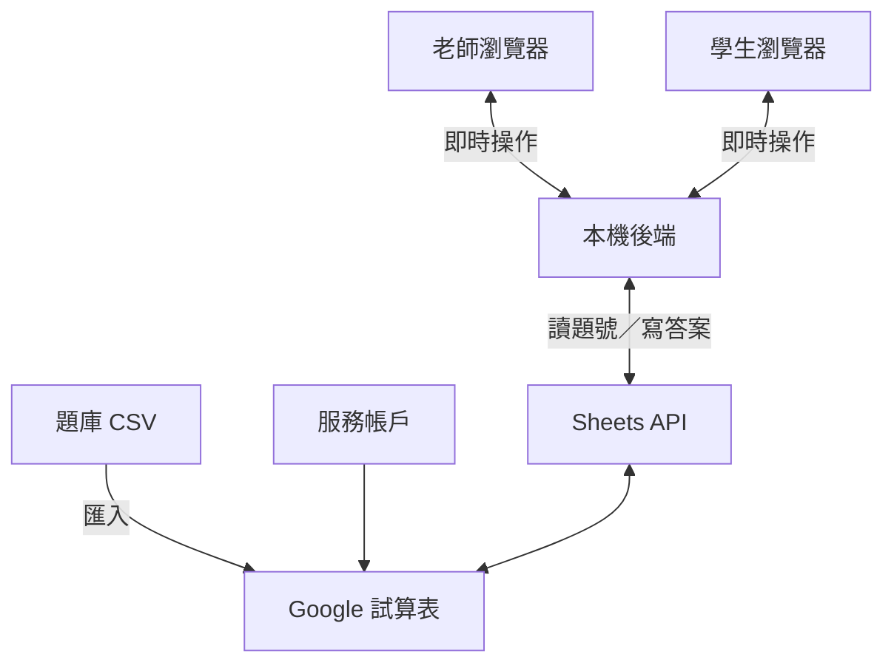

# 課堂即時搶答系統

老師匯入 Google 試算表中的題號，學生以組別搶答，老師查看結果並自行判分。本 README 以 Windows 和 PowerShell 為例，帶你從空白環境開始跑一輪。

> **先知道這個版本的範圍：** 網站會列出題號； **題目文字不會顯示。** 請另外開啟原學習單或投影題目。學生沒有帳號，也沒有「登出／換組」按鈕；目前只適合在同一台電腦示範，尚未部署到教室網路。

## 系統怎麼連在一起？



圖中的「服務帳戶」須有試算表編輯者權限；本機後端透過 Sheets API 讀取題號並寫入答案。前端網址是 `http://127.0.0.1:5173`，後端網址是 `http://127.0.0.1:3001`。網站不能直接上傳電腦中的 CSV；先把 CSV 匯入 Google 試算表，再讓服務帳戶連線。

## 快速開始

### 需要準備

- Windows 電腦、Node.js 24 LTS、npm，以及瀏覽器。
- 一份 Google 試算表和 Google Cloud 服務帳戶。若只想看網站畫面，可以先不設定 Sheets 憑證；但匯入題目時會失敗。
- 從 GitHub 下載或 clone 本專案，並在專案根目錄開啟 PowerShell。根目錄就是同時看得到 `package.json`、`.env.example` 和 `frontend`、`backend` 資料夾的位置。

### 1. 安裝套件並建立 `.env`

在專案根目錄執行：

```powershell
npm ci
if (-not (Test-Path .env)) { Copy-Item .env.example .env }
```

`.env` 應放在 **專案根目錄** 這一層，和 `package.json` 同一層，不是放在 `frontend` 或 `backend` 裡：

```text
專案根目錄/
├─ .env             ← 你的本機設定
├─ .env.example     ← 可複製的範本
├─ package.json
├─ backend/
└─ frontend/
```

用記事本或 VS Code 開啟 `.env`，至少設定老師密碼和學生組別：

```dotenv
TEACHER_PASSWORD=換成你自己的本機測試密碼
GROUP_IDS=1,2,3
GOOGLE_SERVICE_ACCOUNT_JSON=
```

- `TEACHER_PASSWORD`：老師登入用的本機測試密碼，不要使用其他網站的真實密碼。
- `GROUP_IDS`：學生可選的組別，以逗號分隔，例如 `1,2,3` 或 `甲班,乙班`。至少要有一組。
- `.env` 已列入 Git 忽略清單，不要把它提交到 GitHub。
- 範本裡若看到 `GUIDED_NOTES_POC_*` 欄位，那些只供開發者執行 Google API 概念驗證使用，日常啟動可以留白。

### 2. 準備 Google 試算表

1. 在 Google Cloud 建立服務帳戶，啟用 **Google Sheets API v4** 服務，並下載服務帳戶 JSON 金鑰檔。把金鑰檔放在專案資料夾以外。
2. 在 Google 試算表建立一份 **測試用** 試算表。若要使用本專案範例 CSV，開啟試算表後選「檔案 → 匯入 → 上傳」，選取 CSV，再選擇匯入位置。完成後記下試算表網址和底部工作表分頁名稱（例如 `工作表1`）。
3. 從 JSON 金鑰檔找到 `client_email`，在試算表的「共用」中給服務帳戶 **編輯者** 權限。匯入題目需要讀取權限；寫回答案需要編輯權限。

請不要為了方便而把試算表設成「知道連結的任何人都能檢視」。公開連結可能讓讀取成功，但不代表服務帳戶有寫入權限，也會讓拿到連結的人都能看表格；直接分享給服務帳戶即可。若曾為測試開放連結，測完後請關閉連結分享，只保留服務帳戶的必要權限。

本專案附有兩份測試檔：

- [單題範例 CSV](backend/tests/fixtures/feature004/單題_範例_學習單.csv)
- [題組範例 CSV](backend/tests/fixtures/feature004/題組_範例_學習單.csv)：同一份檔案內有單題和題組，可用來測混合題型。

### 3. 讓後端使用 Google 憑證

這裡最容易搞混：目前程式要求 `GOOGLE_SERVICE_ACCOUNT_JSON` 變數裡存放 **JSON 內容** 而不是金鑰檔路徑。因此只填 `C:\keys\service-account.json` 會失敗。

為避免把整份金鑰貼進 `.env`，建議在 **啟動後端的同一個 PowerShell 視窗** 讀取本機金鑰檔，再啟動後端。把範例路徑換成你電腦上的實際位置：

```powershell
$credentialPath = 'C:\keys\service-account.json'
$env:GOOGLE_SERVICE_ACCOUNT_JSON = (
  Get-Content -LiteralPath $credentialPath -Raw |
    ConvertFrom-Json |
    ConvertTo-Json -Compress
)
npm run dev --workspace @speckit-buzzer/backend
```

這段指令不會把金鑰印在畫面上，也不會把金鑰內容寫進 `.env`；後端程式會在本機執行時使用它。每次重新開啟 PowerShell 或重啟後端，都要重新執行設定指令。請注意：目前版本 **不支援只填檔案路徑。** 不要把 JSON 金鑰貼到聊天、GitHub、README 或前端的 `VITE_*` 設定。

### 4. 啟動網站並登入

請保持後端視窗開著，再開啟 **第二個** PowerShell 視窗，切換到同一個專案根目錄並啟動前端：

```powershell
npm run dev --workspace @speckit-buzzer/frontend
```

瀏覽器開啟 [http://127.0.0.1:5173](http://127.0.0.1:5173)。畫面顯示「已連線」後：

1. 老師在一般瀏覽器視窗輸入 `TEACHER_PASSWORD` 設定的密碼登入。
2. 輸入 Google 試算表網址和工作表分頁名稱，按「匯入題號」。確認畫面列出的題數符合預期。
3. 點「開始搶答」。學生在另一個無痕視窗開啟同一網址，選組別並加入。
4. 學生作答送出後，老師結束活動，再自行標記答案正誤。系統不會自動判斷答案。
5. 需要保留本次搶答資料時，可匯出 CSV；需要把勝出答案寫回試算表時，再使用試算表匯出功能。

用第二個無痕視窗模擬另一組。同一個學生分頁加入組別後， **目前不能登出或換組。** 不要用重新整理來換組。若選錯組，開新的無痕視窗再加入。

結束時，在前後端各自的 PowerShell 視窗按 `Ctrl+C` 停止服務。啟動網站的兩個視窗要保持開啟，關掉後網站就無法使用。

## 題庫格式與匯出注意事項

- 匯入的工作表需要有「題號」和「作答」欄；請先用附上的範例 CSV 建立第一份測試表。
- 網站匯入題號與作答欄的結構， **不會讀取或顯示「題目」欄文字。** 學生和老師看到題號是目前版本的預期行為；要讓學生看題目，請另外投影或開啟題目內容。
- 題數是根據匯入的題號計算，不是根據「作答」欄目前有沒有填答案。作答欄空白時題數仍會顯示。
- 題組範例的標記和列格式請直接沿用；詳細格式見 [004 題組說明](specs/004-question-groups/quickstart.md)。
- Google 試算表是題目匯入來源，也是答案寫回目的地；活動中的搶答、順位和分數暫存在後端記憶體，不會因此自動儲存成課堂紀錄。
- 寫回試算表會更新指定的「作答」儲存格；沒有勝出答案的單題格可能被清空。寫回不包含老師的正誤標記或計分板。測試時請只用可丟棄的工作表副本。
- 成功寫回的工作表會留下系統標記，不能再當成全新活動匯入。要重複測試時，請從未寫回的原始範例複製一份新工作表。

## 登入、重設與資料保留

重新登入 **不會重設活動。** 重設按鈕的作用也不是刪除題庫：

| 操作 | 會發生什麼事 |
| --- | --- |
| 老師重新登入 | 目前活動和已匯入題目都保留。 |
| 「重設活動」 | 只在活動結束後使用；保留工作表、題目和公平順位設定，清除本場作答、搶答結果、正誤標記與分數，時限歸零並回到準備中。 |
| 成功匯入另一份工作表 | 以新題目取代目前題目，清除本場作答與計分、時限歸零，保留公平順位設定；匯入失敗會保留原本狀態。 |
| 重啟後端 | 清除存在記憶體中的整場活動、題目、作答、順位和計分；不會刪除 Google 試算表。連線中的瀏覽器會中斷，需等待重新連線。 |

若題數仍在，通常是因為重設會保留題目；若想清除整場測試狀態，可停止並重新啟動後端。重新匯入或重啟後端都不會清除試算表內原有資料，只有明確的試算表寫回操作會改變答案儲存格。

## 常見問題

| 畫面或問題 | 原因與處理方法 |
| --- | --- |
| 顯示「無法讀取此試算表」 | 確認已啟用 Sheets API、網址是 Google 試算表網址、分頁名稱完全相同，而且服務帳戶 `client_email` 已加入共用。匯入需要讀取權限；要寫回請給服務帳戶編輯者權限。 |
| 網頁可以開，匯入卻失敗 | 網頁和後端是兩個服務。確認兩個 PowerShell 視窗都還在執行，並且 Google 憑證是在啟動 **後端的那個視窗** 設定。 |
| 題目只顯示「題目 1、題目 2」 | 這是目前功能限制：題目文字不會匯入或顯示。請另外開啟或投影原學習單。 |
| 登入後題數仍在，或作答欄空白 | 題數按「題號」計算；重新登入和「重設活動」都不會移除已匯入題號。 |
| 學生選錯組，找不到登出 | 目前沒有登出／換組功能。請使用新的無痕視窗加入正確組別。 |
| 網頁顯示無法連線，或啟動時出現連接埠已使用 | 前後端預設使用 `5173` 和 `3001`。通常是另一個專案視窗或上次啟動的服務還開著；先在舊視窗按 `Ctrl+C`，再重啟兩個服務。不要為了排錯關閉所有 Node 程序，避免影響其他專案。 |

## 目前已知限制

- 網站只綁定 `127.0.0.1`：只有啟動程式的這台電腦能連線。其他學生的手機或電腦不能直接加入；目前沒有教室網路或公開部署設定。
- 活動狀態只存在後端記憶體。關閉或重啟後端會失去該場題目、作答、順位、計時和計分；Google 試算表本身不會因此被刪除。
- 學生以組別代表身分，沒有學生帳號或個人驗證；老師需自行判斷答案，沒有自動批改。
- 沒有免憑證的內建 Demo。要從 Google 試算表匯入題目，必須完成服務帳戶和試算表分享設定。

## 開發者指令

以下指令都從專案根目錄執行。一般使用者不需要執行測試：

```powershell
npm run typecheck
npm test
npm run test:e2e
npm run build
```

端對端測試會使用本機模擬的 Google Sheets，不需要真實服務帳戶。執行前請先停止手動啟動的前後端服務，避免測試和網站搶用連接埠。

## 深入文件

- [001 角色與階段同步](specs/001-role-phase-sync/quickstart.md)
- [002 Google Sheets 匯入與匯出](specs/002-guided-notes-import-export/quickstart.md)
- [003 搶答結果](specs/003-buzzer-results/quickstart.md)
- [004 題組與多填空](specs/004-question-groups/quickstart.md)
- [005 公平順位與 CSV 匯出](specs/005-buzzer-ranking-export/quickstart.md)
- [006 計時、人工計分與本組進度](specs/006-timed-scoring/quickstart.md)
- [001–006 合併與驗收稽核](specs/acceptance-audit-001-006.md)

